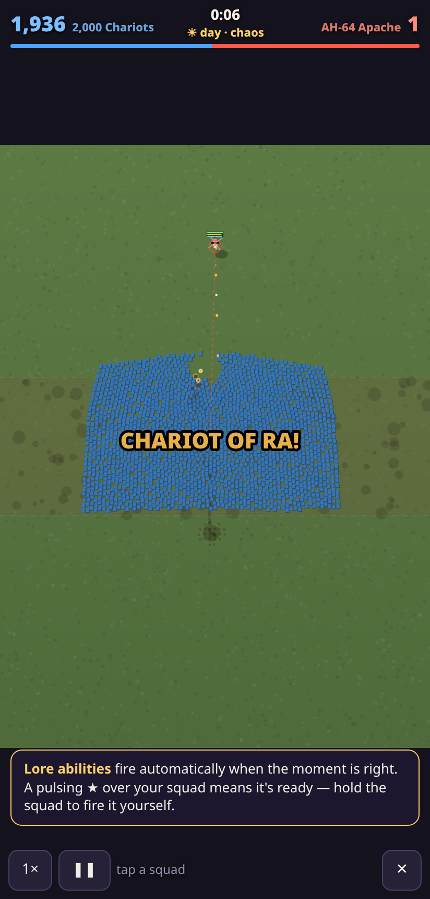

# ⚔ Timeline Brawl

**Every era. Same budget. Who wins?** Units from five eras of history share one battlefield. Both sides get the same point budget, so numbers can beat tech: an Apache costs as much as 2,000 chariots. Draft an army, deploy it, call the winner, then watch the auto-battle.

**Play:** https://miketripleog.github.io/timeline-brawl/ (phone or desktop)

## How to play

1. **Pick a featured matchup** (one tap) or **Draft an army**: vs AI or 2 players on one device, with a 5k / 10k / 20k budget, day / night / storm, and chaos events on or off.
2. **Deploy:** drag your squads anywhere inside your shaded zone, then press **FIGHT!**
3. **Who wins?** Lock in a prediction. You get called out at the end if it was an upset.
4. **Battle controls** (one gesture per action, no menus):
   - Tap one of your squads to select it.
   - Tap the ground to move it there.
   - Tap an enemy squad to attack it.
   - **Press and hold** one of your squads to fire its lore ability. A pulsing ★ means the ability is ready.

   Leave everything alone and the units fight on their own. Lore abilities also fire automatically when the moment is right.
5. The **result** screen shows the winner, survivors per squad, the MVP and whether you called it. Then go for a rematch.

The first time each system appears (lore abilities, morale, ammo, fuel, landing, chaos events), a one-line tip explains it. All features are on from the start.

### Core mechanics
- **Counters:** Longbows shred light cavalry. Spears and pikes stop charges. Testudo shrugs off arrows and bullets but not shells. Swarms of melee units chip through vehicle armor.
- **Modern units run dry.** Tanks, helicopters, planes, SEALs and Javelin teams carry limited ammo (yellow bar), and vehicles and aircraft also have fuel (blue bar):
  - Out-of-ammo vehicles get bogged down and swarmed.
  - Aircraft with empty racks return to base and land.
  - Aircraft that run out of fuel land where they are.
  - Landed aircraft are easy prey.
- **Morale:** a squad that loses most of its troops can rout.
- **Chaos events** (optional) hit three times per battle, each with a full-screen color shift and a sound cue: Sandstorm, Black Death, Total Eclipse (all aircraft land), Betrayal (squads switch sides), EMP, Alien Abduction, Monsoon.
- **Weather:** night cuts accuracy for pre-modern troops and blocks sun-powered abilities. Storm soaks bowstrings and gunpowder.

## Units and lore abilities
Each unit has one myth-based ability with a cooldown and a counter.

### Ancient

| Unit | Role | Cost | Lore ability | Counter |
|---|---|---|---|---|
| Spartan Hoplites | Infantry | 3 (packs of 50) | **THERMOPYLAE HOLD** — When badly outnumbered the phalanx locks shields: immovable, takes 75% less melee, arrow and bullet damage for 7s. (cooldown 25s) | Explosives, fire and missiles ignore the shield wall. |
| Roman Legionaries (testudo) | Infantry | 2 (packs of 100) | **BLESSING OF MARS** — The god of war answers: heals 25% and +60% damage for 6s. Passive testudo blocks most arrows and bullets. (cooldown 30s) | An eclipse is a bad omen (blocked); Black Death blocks the healing; packed testudo takes extra shell damage. |
| Persian Immortals | Ranged | 3 (packs of 50) | **THE TEN THOUSAND** — For 8s, each fallen Immortal has a 60% chance to be instantly replaced from the rear, keeping the legend of an army that never shrinks. (cooldown 30s) | Fire and explosive deaths are not replaced; Black Death blocks it. |
| Egyptian Chariots | Cavalry | 5 (packs of 40) | **CHARIOT OF RA** — The sun god drives the charge: double speed and triple trample damage for 4s. (cooldown 20s) | Spears and pikes blunt the charge; useless at night or in an eclipse. |
| Archimedes' Mirrors | Siege | 150 (packs of 2) | **ARCHIMEDES' DEATH RAY** — Polished bronze focuses the sun on the biggest enemy vehicle, aircraft or siege engine within 320: it burns for 6s (about 30% of its HP). (cooldown 18s) | Daytime only: night, storms, sandstorms and eclipses shut it down. |
| Trojan Horse | Siege | 400 | **THE TROJAN HORSE** — Once per battle the "gift" appears behind enemy lines and, 2.5s later, 30 Greek hoplites pour out. (cooldown once per battle) | Burn or blow it up before it opens and the hidden troops die inside. |

### Medieval

| Unit | Role | Cost | Lore ability | Counter |
|---|---|---|---|---|
| Viking Berserkers | Infantry | 5 (packs of 40) | **BERSERKERGANG** — They feel no pain: for 5s they keep fighting at 0 HP with +50% damage, and only fall when the rage ends. (cooldown 22s) | Fire, shells and missiles still kill them outright; shoot them before they reach you. |
| English Longbowmen | Ranged | 4 (packs of 50) | **AGINCOURT VOLLEY** — Arrows blot out the sun: every archer instantly looses 3 double-damage arrows. Murderous against cavalry. (cooldown 20s) | Rain or storms mean wet bowstrings (blocked); shields, testudo and armour shrug it off. |
| Knights Templar | Cavalry | 15 (packs of 20) | **THE HOLY GRAIL** — The Grail heals every surviving knight to full and makes them untouchable for 2.5s. (cooldown 35s) | It cannot raise the dead, and Black Death blocks all healing. Pikes still impale them. |
| Mongol Horse Archers | Cavalry | 6 (packs of 40) | **FEIGNED RETREAT** — They flee... then wheel around: for 4s double damage, and undisciplined pursuers are disordered (take +60% damage). (cooldown 20s) | Disciplined troops (phalanx, legion, pikes, knights, machine guns, modern units) do not take the bait; longbows outrange them. |
| Byzantine Greek Fire | Siege | 80 (packs of 4) | **GREEK FIRE** — The secret liquid fire: a 30-wide pool that burns everything in it for 6s and cannot be put out by water... supposedly. (cooldown 15s) | Rain, storms and the divine wind douse it; very short range. |
| Samurai | Infantry | 8 (packs of 30) | **KAMIKAZE — DIVINE WIND** — Once per battle a typhoon scatters every enemy aircraft (8s grounded and out of fuel) and hurls nearby enemies back. (cooldown once per battle) | One use only; does nothing to tanks and other ground armour. |

### Gunpowder

| Unit | Role | Cost | Lore ability | Counter |
|---|---|---|---|---|
| Swiss Pikemen | Infantry | 4 (packs of 50) | **WILLIAM TELL'S SHOT** — The legendary crossbowman fires one perfect bolt at the most valuable enemy within 250: 35% of its max HP, ignoring armour. (cooldown 30s) | Range 250: tanks and helicopters that stay back are safe. |
| Musketeers | Ranged | 6 (packs of 40) | **JOAN OF ARC'S BANNER** — A vision of the Maid: for 8s all allies within 160 cannot break, deal +25% and take -20% damage. (cooldown 30s) | The banner falls if the musketeers drop below 25%. |
| Winged Hussars | Cavalry | 14 (packs of 20) | **WINGS OF VIENNA** — The terrifying roar of the wings: a 3s charge at x2.5 damage, and nearby undisciplined enemies flee in panic. (cooldown 25s) | Pikes and spears stop the charge; disciplined troops and machines are not scared. |
| Cannon Battery | Siege | 120 (packs of 3) | **SAINT BARBARA'S FIRE** — The patron saint of gunners blesses the next 3 shots: they never miss and have triple blast radius. (cooldown 25s) | Slow reload; fast cavalry that reaches the guns overruns them. |
| Ninja (Shinobi) | Infantry | 15 (packs of 15) | **SMOKE BOMB VANISH** — Passive: invisible until they strike. Ability: vanish in smoke and blink 50 deeper into the enemy, untouchable for 3s. (cooldown 12s) | Modern radar and thermal units see them within 150; explosions still hit them. |

### World Wars

| Unit | Role | Cost | Lore ability | Counter |
|---|---|---|---|---|
| British Tommies (WW1) | Infantry | 12 (packs of 25) | **THE ANGELS OF MONS** — When the squad is half dead, ghostly bowmen of Agincourt appear behind them for 7s and cover the retreat with volleys. (cooldown 35s) | Ghost arrows barely scratch tanks or aircraft; it only lasts 7s. |
| Machine-Gun Trench (WW1) | Ranged | 400 (packs of 2) | **NO MAN'S LAND DESERTERS** — The legendary wild deserters living under no man's land burst out among enemies crossing it: 15 feral fighters join your side. (cooldown 30s) | Only works on enemies in the middle no man's land band; vehicles shrug them off. |
| Sherman Tank (WW2) | Vehicle | 1500 | **THE GHOST ARMY** — 4 inflatable decoy tanks pop up around the Sherman for 12s and draw enemy fire. (cooldown 30s) | One hit pops a decoy; radar-equipped modern units see straight through them. |
| P-51 Mustang (WW2) | Air | 2500 | **FOO FIGHTERS** — Mysterious glowing orbs swarm the plane for 6s and jam the targeting of every enemy with electronics within 260 (-75% accuracy). (cooldown 25s) | Ancient, medieval and gunpowder troops have no targeting electronics to jam. |

### Modern

| Unit | Role | Cost | Lore ability | Counter |
|---|---|---|---|---|
| Navy SEALs | Infantry | 90 (packs of 10) | **PHILADELPHIA EXPERIMENT** — When cornered in melee the squad vanishes and rematerialises 130 away on a flank, invisible for 4s. (cooldown 25s) | They reappear dazed and cannot fire for 1s; explosions still hit them. |
| Javelin Missile Team | Ranged | 500 (packs of 2) | **ROSWELL LOCK-ON** — Reverse-engineered alien seekers: the next 2 missiles cannot miss and ignore jamming, cloaks and decoys. (cooldown 30s) | Only 4 missiles per team, and they are wasted on swarms. |
| M1 Abrams Tank | Vehicle | 10000 | **DESERT STORM LEGEND** — The tank that could not be killed: invulnerable for 4s and repairs 20%. (cooldown 40s) | It does not refill ammo or fuel: once dry it is just a steel box waiting to be swarmed. |
| AH-64 Apache | Air | 10000 | **GHOST OF KYIV** — A legendary ace takes the stick: for 6s rockets cost no ammo and incoming fire mostly misses. (cooldown 30s) | Burns fuel 3x faster, so it has to land sooner, and landed helicopters get swarmed. |

## Featured matchups
| Matchup | What decides it |
|---|---|
| 300 Spartans vs 10 Navy SEALs | Can the SEALs' 1,600 rounds stop 300 shields before the phalanx closes? Usually no, but sometimes. |
| 5,000 Legionaries vs 1 M1 Abrams | The testudo holds until the Abrams runs out of ammo, then the swarm finishes it. Sometimes the tank wins. |
| 400 Mongol Horse Archers vs 6 MG nests | Feigned retreat against the Maxim gun. A coin flip. |
| 2,000 Chariots vs 1 AH-64 Apache | Same price tag. The Apache mows down hundreds, but when it runs out of fuel it has to land... |
| 310 Samurai vs 1 P-51 Mustang | Strafing runs against the divine wind. Very close. |
| Longbowmen + Pikes vs Knights & Winged Hussars | An Agincourt rematch. |

## Tech
- Plain static HTML, CSS and JS. No build step, no backend, no dependencies.
- `js/units.js` holds the data. `js/sim.js` is a deterministic fixed-step simulation (30 Hz) using typed arrays (up to 14,000 units), a spatial hash rebuilt every tick with a counting sort, and pooled projectiles. `js/armies.js` has the presets, layout and AI draft. `js/render.js` draws on a canvas with batched rectangles. `js/audio.js` is a WebAudio synth with no asset files. `js/ui.js` handles screens, input and the game loop.
- Run it locally with `python3 -m http.server` and open http://localhost:8000.

### Tests
- `node test/simtest.cjs 6 nochaos [matchupId]` runs headless balance batches in node.
- `node test/trace.cjs <matchupId> <seed>` prints a battle trace.
- `node test/e2e.cjs http://127.0.0.1:8765/` runs a Playwright test at a 412×860 phone viewport. It needs `playwright-core` and Chrome.
